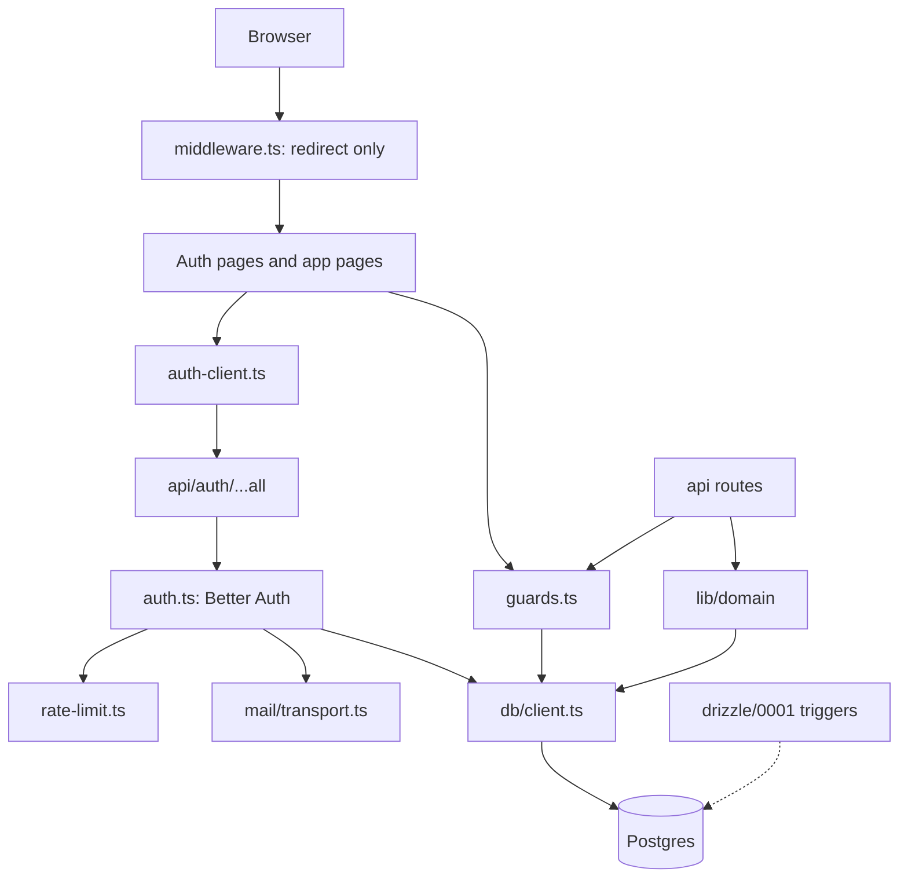

# Plan: data layer and authentication

Drizzle ORM, PostgreSQL, Better Auth (Google + email and password). This plan replaces all earlier drafts. It follows `AGENTS.md`, `docs/schema.md`, `docs/prd.md` and decisions D-019 to D-023.

## 0. How this plan is organized

- **Section 1** lists what is decided and what must be verified in a short spike before building. Several Better Auth option names and behaviors in this plan are from memory and are marked **(verify)**.
- **Sections 2 to 7** are the design: database, auth, routing, tests, tooling.
- **Section 8** is the build order, with a gate after every step.
- **Section 9** lists accepted risks and open questions.

## 1. Decisions and assumptions

### Locked

| Area | Decision |
|---|---|
| ORM | Drizzle over `pg`, pooled `DATABASE_URL` for the app, `DIRECT_URL` for migrations only |
| Auth | Better Auth, Drizzle adapter, Google + email and password, verification required before sign-in |
| Email | Own SMTP through Nodemailer, sent in the background with `waitUntil` |
| Invariants | Balance triggers are deferred constraint triggers, with integration tests on a real database |
| Redirects | One `safeRedirect()` for every redirect target |
| Placeholders | `.invalid` addresses cannot sign up, sign in, reset, or receive mail |
| Next.js | 15.1.x, so the file is `src/middleware.ts` |

### Pin versions

Pin exact versions (no `^`) for `better-auth`, `drizzle-orm`, `drizzle-kit` and `vitest` until the auth integration tests pass. Upgrade deliberately, one package at a time, with the tests as the gate.

### Spike before building (Step 1)

Run a throwaway branch against a scratch database and record the answers in `docs/spikes/better-auth.md`. Each item decides a detail below.

| # | Question | Decides |
|---|---|---|
| S1 | Exact option names: `emailVerification.sendOnSignUp`, `autoSignInAfterVerification`, `emailAndPassword.requireEmailVerification`, `resetPasswordTokenExpiresIn`, `revokeSessionsOnPasswordReset`, `rateLimit.storage`, `advanced.ipAddress` | The `auth.ts` skeleton |
| S2 | Sign-up with an email that already has an unverified user: does it error, resend, replace, or fake success? And with a verified user? | Section 3.3 |
| S3 | Does `databaseHooks.account.create.before` fire when Google links to an existing user, and what does it receive? | Pre-hijack defense |
| S4 | What exactly does the verify redirect append on failure, and does it survive a `callbackURL` that already has `?next=`? | Verify page |
| S5 | Real endpoint paths for sign-in, sign-up, forgot password and resend verification | Rate-limit rules and hooks |
| S6 | Which request header holds the client IP on Vercel, and what does Better Auth read by default? | Rate limiting |
| S7 | Can the Google provider be made testable (`getUserInfo` or `verifyIdToken` overrides, ID-token sign-in)? | Linking tests |
| S8 | Table and column names the Better Auth CLI generates for the Drizzle adapter, including `rateLimit` | Schema step 2a |
| S9 | Does `autoSignInAfterVerification` set the cookie on the verify redirect response? | Verify page states |
| S10 | Does `revokeSessionsOnPasswordReset` revoke every other session? | Reset test |
| S11 | Does `updateUser` honor `input: false`? | `PATCH /api/me` |
| S12 | Does the installed Vitest support `projects` with `extends: true`? | Test config |

Exit: every row answered, plan edited where reality differed.

## 2. System overview



Rules that follow from the diagram: pages and routes never import the database client; only `guards.ts`, `auth.ts`, `lib/db/queries/*` and `lib/domain/*` do. Authorization lives in `guards.ts` and queries, never in middleware.

## 3. Authentication design

### 3.1 Config skeleton `src/lib/auth/auth.ts` (verify option names with S1)

Build it as a factory so tests exercise the real hooks:

```ts
export function createAuth(overrides: Partial<BetterAuthOptions> = {}) {
  return betterAuth({
    database: drizzleAdapter(db, { provider: "pg", schema: { user: users, session: sessions, account: accounts, verification: verifications, rateLimit: rateLimits } }),
    baseURL: appUrl,
    secret: process.env.BETTER_AUTH_SECRET,
    trustedOrigins: [appUrl],
    account: { accountLinking: { enabled: true, trustedProviders: ["google"] } },
    emailVerification: {
      sendOnSignUp: true,
      autoSignInAfterVerification: true,
      sendVerificationEmail: async ({ user, url }) => { sendInBackground(sendVerificationEmail({ to: user.email, url })); },
    },
    emailAndPassword: {
      enabled: true,
      requireEmailVerification: true,
      minPasswordLength: 10,
      maxPasswordLength: 128,
      resetPasswordTokenExpiresIn: 3600,
      revokeSessionsOnPasswordReset: true,
      sendResetPassword: async ({ user, url }) => { sendInBackground(sendPasswordResetEmail({ to: user.email, url })); },
    },
    socialProviders: previewEnv ? {} : { google: { clientId, clientSecret } },
    rateLimit: { storage: "database", window: 60, max: 30 },
    advanced: { ipAddress: { ipAddressHeaders: ["x-forwarded-for"] } },
    user: { additionalFields: userFields },
    databaseHooks,
    hooks: { before: emailRateLimitHook, after: failedSignInHook },
    ...overrides,
  });
}
export const auth = createAuth();
```

- `appUrl`: `VERCEL_ENV === "preview"` uses `https://${VERCEL_BRANCH_URL ?? VERCEL_URL}`, everything else uses `NEXT_PUBLIC_APP_URL`. Google is disabled in previews because its redirect URIs can't be registered per deployment. Email and password only there.
- `sendInBackground(promise)` calls `waitUntil(promise.catch(log))`. Logs carry the error message only, never the URL or token.
- `userFields`: `status` (`input: false`), `phone` (`input: false`), `upiId` (`input: false`), `defaultCurrency` (`input: true`), `mergedIntoId` (`input: false`), `deletedAt` (`input: false`).
- No `changeEmail`. Enabling it reopens account takeover paths.
- No custom password hashing. Better Auth's default stays.

### 3.2 Placeholder emails

`src/lib/utils/email.ts`:

```ts
export function isPlaceholderEmail(email: string): boolean {
  const at = email.lastIndexOf("@");
  if (at === -1) return false;
  const domain = email.slice(at + 1).trim().toLowerCase().replace(/\.+$/, "");
  return domain === "invalid" || domain.endsWith(".invalid");
}
```

- `databaseHooks.user.create.before` throws a 400 for placeholder emails. Domain code that creates placeholder rows (`INVITED`) inserts through Drizzle, not Better Auth, so the hook doesn't affect it.
- `transport.ts` refuses placeholder recipients as a second line of defense.
- Unit tests: `a@x.invalid`, `a@invalid`, `A@SUB.INVALID.`, `a@x.invalid ` and valid addresses.

### 3.3 Pre-hijack defense

The attack: someone registers a victim's email with their own password.

Layers, in order:

1. `requireEmailVerification` means that unverified password account can never sign in.
2. `phone` and `upiId` are `input: false`, so an attacker can't plant payment details at sign-up. They're set only through `PATCH /api/me` after verification.
3. **Google link:** in `databaseHooks.account.create.before`, when `providerId === "google"` and the target user is unverified: delete that user's credential account, sessions and pending verification rows; set `name` to the email's local part and clear `image`. **Keep the user row** (the incoming account insert needs it).
4. **Forgot password** proves mailbox control and replaces the attacker's password. Make sure it works for unverified accounts (S2, S5).
5. The verification email says: "Someone created a Spending Diary account with this address. If that was you, confirm it. If not, ignore this email."

**Do not** purge an unverified user row inside `user.create.before`. If the real owner started a sign-up, an attacker's later sign-up would delete that row, and the owner's earlier verification link could then verify the attacker's account. Decide this only after S2 shows what Better Auth does on duplicate sign-ups.

**Residual risk (accepted for Phase 1, recorded in D-021):** if the real owner clicks a verification link that the attacker triggered, and later links Google, the attacker's password may still work. This needs an unrequested email, a click, and a later Google link. Hardening if you want to close it fully: verify-first sign-up (collect only name and email, verify, then set the password on an authenticated page). That is more custom code and more screens, so defer it to Phase 2 unless the spike shows it's cheap.

Required tests (Section 7): Google link purges credential; the attacker password is rejected afterwards; sign-up does not set `phone` or `upiId`; the victim can still reset and sign in.

### 3.4 Rate limiting

Two layers.

1. Better Auth's built-in limiter, database-backed (`rate_limits` table), per IP and path, with a generous default plus tighter rules on the real endpoint names (S5).
2. A custom per-email limiter in `src/lib/auth/rate-limit.ts`, because the PRD (AUTH-6) wants per-email limits.

Per-email table:

```ts
export const emailRateLimits = pgTable("email_rate_limits", {
  key: text("key").primaryKey(),
  count: integer("count").notNull(),
  windowEndsAt: timestamp("window_ends_at", { withTimezone: true }).notNull(),
});
```

Atomic consume (all time math in the database):

```sql
INSERT INTO email_rate_limits (key, count, window_ends_at)
VALUES ($1, 1, now() + make_interval(secs => $2))
ON CONFLICT (key) DO UPDATE SET
  count = CASE WHEN email_rate_limits.window_ends_at < now() THEN 1 ELSE email_rate_limits.count + 1 END,
  window_ends_at = CASE WHEN email_rate_limits.window_ends_at < now()
                        THEN now() + make_interval(secs => $2) ELSE email_rate_limits.window_ends_at END
RETURNING count;
```

Policy:

| Action | Key (hashed) | Limit | Counts |
|---|---|---|---|
| Sign-in | `sha256(email)` + IP | 5 per 15 min | failures only (`peek` before, `recordFailure` in `hooks.after`) |
| Sign-up | email | 3 per 10 min | every request |
| Forgot password | email, and IP | email 3 per 10 min, IP 10 per 10 min | every request |
| Resend verification | email, and IP | email 3 per 10 min, IP 10 per 10 min | every request |

- Keys are `sha256` hashes, so the table holds no raw emails.
- If the client IP is unknown, key sign-in on the email alone with a higher limit. Never fall back to a shared constant like `127.0.0.1`: one attacker could lock out everyone.
- A per-email cap lets an attacker use up a victim's reset or resend quota. The per-IP cap and a user-facing "try again later" message are the accepted trade-off.
- Expired rows are deleted by the daily cron route (Section 6.3).

### 3.5 Verification and destination preservation

- Sign-up passes `callbackURL: "/verify-email?next=" + encodeURIComponent(safeRedirect(dest, "/home"))`. The emailed link hits Better Auth, which verifies, signs the user in (S9) and redirects to the callback. Failures add an error parameter (S4).
- `/verify-email` page states:
  1. `error` present: "Verification failed. This link has expired or was already used." with "Send a new link".
  2. Session present and verified: "Email verified." with "Continue" to `safeRedirect(next, "/home")`.
  3. No session (common in Gmail's in-app browser, which has its own cookie jar): "If you just verified your email, sign in to continue." with "Sign in" (to `/login?callbackUrl=<next>`) and "Send a new link".
- Never put a success flag in the URL.
- Sentence case, no arbitrary colors, per `docs/design.md`.

### 3.6 Settings and sessions

- `PATCH /api/me` (`src/app/api/me/route.ts`): `requireSession`, Zod (`src/lib/validation/user.ts`), updates `name`, `phone`, `upiId`, `defaultCurrency` through a function in `lib/domain/users.ts`. `upiId` format check: `^[\w.\-]{2,256}@[a-zA-Z]{2,64}$`.
- Onboarding forces the name step if `name` equals the email local part.
- Account deletion (PRD SETT-5) is a later task; the design is in `docs/schema.md` section 7.7.

## 4. Database design

### 4.1 Schema rules (`src/lib/db/schema.ts`)

Follow `docs/schema.md` and the "Database conventions" in AGENTS.md. In short: integer amounts, `bigint({ mode: "bigint" })` for the balance cache, `bigserial` ledger ids, `date(..., { mode: "string" })` for expense dates, timestamps with time zone, cuid2 ids, `{ onDelete: "restrict" }` on money foreign keys, CHECK constraints and partial indexes declared in the schema. Add `email_rate_limits` and Better Auth's `rate_limits`.

### 4.2 Client `src/lib/db/client.ts`

- `pg` Pool cached on `globalThis` in development, `max: 2` in production (`10` in dev), `idleTimeoutMillis: 5000`, `connectionTimeoutMillis: 5000`.
- Export `db`, `Database`, and `DbTx = Parameters<Parameters<typeof db.transaction>[0]>[0]`.
- Use the provider's transaction pooler URL. No HTTP drivers.

### 4.3 Migrations

- `drizzle.config.ts` at the repo root throws if `DIRECT_URL` is missing. It never falls back to `DATABASE_URL`.
- Apply migrations from CI or a local command, never at request time or in the Vercel build.
- Deploy order: migrate, then deploy. Breaking changes use expand then contract across two releases.
- Never hand-edit generated SQL or `meta/` snapshots. Never `drizzle-kit push` on a shared database.
- Verify cadence: `drizzle-kit generate` must report nothing pending after your migration, and `drizzle-kit check` must pass.

### 4.4 Balance triggers `drizzle/0001_balance_deferred_triggers.sql`

Created with `npx drizzle-kit generate --custom --name=balance_deferred_triggers`.

```sql
CREATE OR REPLACE FUNCTION check_expense_balanced_by_id(p_expense_id TEXT)
RETURNS VOID AS $$
DECLARE
  v_paid BIGINT; v_owed BIGINT; v_amount BIGINT; v_deleted TIMESTAMPTZ;
BEGIN
  SELECT amount, deleted_at INTO v_amount, v_deleted FROM expenses WHERE id = p_expense_id;
  IF NOT FOUND OR v_deleted IS NOT NULL THEN RETURN; END IF;
  SELECT COALESCE(SUM(paid), 0), COALESCE(SUM(owed), 0)
    INTO v_paid, v_owed FROM expense_participants WHERE expense_id = p_expense_id;
  IF v_paid <> v_amount OR v_owed <> v_amount THEN
    RAISE EXCEPTION 'Expense % unbalanced: amount=%, paid=%, owed=%', p_expense_id, v_amount, v_paid, v_owed
      USING ERRCODE = 'check_violation';
  END IF;
END $$ LANGUAGE plpgsql;

CREATE OR REPLACE FUNCTION trg_fn_participant_balance() RETURNS TRIGGER AS $$
BEGIN
  IF TG_OP = 'DELETE' THEN
    PERFORM check_expense_balanced_by_id(OLD.expense_id); RETURN OLD;
  ELSIF TG_OP = 'UPDATE' AND OLD.expense_id <> NEW.expense_id THEN
    PERFORM check_expense_balanced_by_id(OLD.expense_id);
    PERFORM check_expense_balanced_by_id(NEW.expense_id); RETURN NEW;
  ELSE
    PERFORM check_expense_balanced_by_id(NEW.expense_id); RETURN NEW;
  END IF;
END $$ LANGUAGE plpgsql;

DROP TRIGGER IF EXISTS trg_participants_balance_check ON expense_participants;
CREATE CONSTRAINT TRIGGER trg_participants_balance_check
AFTER INSERT OR UPDATE OR DELETE ON expense_participants
DEFERRABLE INITIALLY DEFERRED FOR EACH ROW EXECUTE FUNCTION trg_fn_participant_balance();

CREATE OR REPLACE FUNCTION trg_fn_expense_balance() RETURNS TRIGGER AS $$
BEGIN
  IF TG_OP = 'INSERT' THEN
    PERFORM check_expense_balanced_by_id(NEW.id);
  ELSIF NEW.amount <> OLD.amount OR (OLD.deleted_at IS NOT NULL AND NEW.deleted_at IS NULL) THEN
    PERFORM check_expense_balanced_by_id(NEW.id);
  END IF;
  RETURN NEW;
END $$ LANGUAGE plpgsql;

DROP TRIGGER IF EXISTS trg_expenses_balance_check ON expenses;
CREATE CONSTRAINT TRIGGER trg_expenses_balance_check
AFTER INSERT OR UPDATE OF amount, deleted_at ON expenses
DEFERRABLE INITIALLY DEFERRED FOR EACH ROW EXECUTE FUNCTION trg_fn_expense_balance();
```

Soft-deleted expenses are skipped, and restoring one re-checks it. Row-level deferred triggers re-check once per changed row, which is negligible at under about 20 participants.

## 5. Routing and sessions

### 5.1 `safeRedirect` (`src/lib/utils/url.ts`)

Resolve the target against a dummy origin; return the fallback on control characters, a leading `//`, `/\` or `\`, a different origin, or a parse error; otherwise return `pathname + search + hash`. Used by middleware, the login page, sign-up callbacks and the verify page. No other redirect validation exists anywhere.

Unit tests: `/groups/1?tab=balances#x` (kept), `/\evil.com`, `//x`, `/%2f/x`, `/.//evil.com`, a tab inside the path, `javascript:alert(1)`, `https://evil.com`, empty string, `null`.

### 5.2 Middleware `src/middleware.ts`

- Runs only for protected prefixes: `/home /groups /friends /expenses /activity /insights /settings`.
- No session cookie: redirect to `/login?callbackUrl=<safeRedirect(pathname + search)>`.
- It does **not** redirect away from `/login`. A stale cookie must reach the page, which checks the real session.
- Matcher excludes `_next`, static assets, the service worker, `j/` and `api/auth`.
- Cookie detection uses `getSessionCookie` from `better-auth/cookies`, so production's prefixed cookie name works.

### 5.3 Guards `src/lib/auth/guards.ts` (`import "server-only"`)

| Function | Used by | Behavior |
|---|---|---|
| `requireSession(req)` | route handlers | returns `{ userId, email }`, throws `UnauthorizedError` (401). Also rejects users whose `status` is not `ACTIVE`. |
| `assertServerSession()` | protected pages and layouts | `redirect("/login")` when missing |
| `getOptionalSession()` | `/login` and `/verify-email` only | returns the session or `null`; logs errors |
| `assertGroupMember(viewerId, groupId)` | queries and domain | throws `NotFoundError` (404) for non-members and removed members |

Pages never import `auth` directly. Errors map to the `{ error: { code, message, fields? } }` envelope through `toErrorResponse` in `src/lib/utils/errors.ts`.

### 5.4 Login page

Server component: `getOptionalSession()`; if a real session exists, `redirect(safeRedirect(callbackUrl))`; otherwise render the form with the validated callback.

## 6. Mail, cron and environment

### 6.1 Mail `src/lib/mail/transport.ts`

- Nodemailer SMTP, 587 or 465. Create the transporter lazily, once per instance.
- SPF, DKIM and DMARC set up before launch. Test deliverability to Gmail and Outlook.
- Test mode: `setTestMailbox(array | null)` pushes synchronously, before any background send, and throws if `NODE_ENV === "production"`. No imports from `tests/` in `src/`.

### 6.2 Environment variables

| Variable | Used for |
|---|---|
| `DATABASE_URL` | pooled app connection |
| `DIRECT_URL` | migrations only |
| `TEST_DATABASE_URL` | integration tests only, database name must end in `_test` |
| `BETTER_AUTH_SECRET`, `NEXT_PUBLIC_APP_URL` | auth |
| `GOOGLE_CLIENT_ID`, `GOOGLE_CLIENT_SECRET` | Google (not set in previews) |
| `SMTP_HOST`, `SMTP_PORT`, `SMTP_USER`, `SMTP_PASS`, `MAIL_FROM` | email |
| `CRON_SECRET` | cron route auth |

Commit `.env.example` and `.env.test.example`. Never commit real values.

### 6.3 Daily cleanup cron

A Vercel cron (the free plan allows daily) calls `GET /api/cron/cleanup` with `Authorization: Bearer ${CRON_SECRET}`. It deletes expired `email_rate_limits`, Better Auth `rate_limits` and `verifications` rows. The same route family later runs the nightly balance reconciliation from the PRD.

## 7. Testing

### 7.1 Projects

Two Vitest projects, both with `extends: true` so aliases apply (S12):

- **unit:** `tests/unit/**`, `tests/utils/**`, `tests/auth/mail-guard.test.ts`. No database, no env requirements.
- **integration:** `tests/integration/**`, `tests/db/**`, `tests/auth/**`. Serial (`fileParallelism: false`), uses `globalSetup` and a setup file.

Aliases: `@` to `src`, `server-only` to an empty stub.

### 7.2 Database safety (`tests/global-setup.ts` and `tests/setup-db.ts`)

Two files, in this order:

1. **`tests/global-setup.ts`** loads `.env.test`, requires `TEST_DATABASE_URL`, parses the database name and refuses unless it ends in `_test` and differs from `DATABASE_URL` and `DIRECT_URL`. It connects with a plain `pg` client, confirms `SELECT current_database()` ends in `_test`, then runs migrations with `migrate(db, { migrationsFolder: "./drizzle" })`.
2. **`tests/setup-db.ts`** sets `process.env.DATABASE_URL = TEST_DATABASE_URL` at the very top, **before** any import of `@/lib/db/client`, then imports `{ beforeAll, afterEach } from "vitest"` and the client dynamically. Before each truncate it re-runs `SELECT current_database()` and throws unless the name ends in `_test`.

Truncate everything dynamically so the list never goes stale:

```sql
SELECT tablename FROM pg_tables WHERE schemaname = 'public';
-- then: TRUNCATE <all of them> RESTART IDENTITY CASCADE
```

(Migrations metadata lives in the `drizzle` schema, so it's untouched.)

### 7.3 Test database provisioning

- `docker-compose.test.yml`: `postgres` at the same major version as production, database `spending_diary_test`, port 5433, `tmpfs`, a healthcheck.
- Windows needs Docker Desktop. If that is a burden, use a separate free-tier project with a name ending in `_test`.
- `pretest:integration` script: `docker compose -f docker-compose.test.yml up -d --wait`.

### 7.4 Test matrix

| Area | Cases |
|---|---|
| Triggers | zero participants rejected; unbalanced insert rejected at commit; participant delete that unbalances rejected; `amount` change without participants rejected; restore of an unbalanced expense rejected; restore of a balanced one allowed; participant moved to another expense checks both; balanced multi-statement transaction allowed; intermediate imbalance allowed inside one transaction |
| Mail guard | placeholder variants rejected, normal addresses accepted |
| `safeRedirect` | cases in 5.1 |
| Auth flow | sign-in blocked until verified; verification email captured and link works; sign-up for an existing email returns the same response shape; reset link expires, works once, and signs out other sessions; invite `next` survives sign-up, verify and login; sign-up cannot set `phone` or `upiId`; `.invalid` sign-up rejected |
| Pre-hijack | attacker registers victim email, victim signs in with Google: credential gone, attacker password rejected, victim can reset and sign in |
| Rate limits | per-email limit atomic under concurrent calls; sign-in counts failures only; no shared-bucket lockout when IP is missing |
| Guards | `requireSession` 401; non-member and removed member get 404; non-ACTIVE users rejected |
| Google mock | tests run on `createAuth({ socialProviders: { google: { ..., getUserInfo } } })` using the real hooks (S7) |

### 7.5 Property tests

`fast-check` for `splits.ts`, `ledger.ts` and `simplify.ts` (totals preserved), as in AGENTS.md. These are unit-project tests.

## 8. Tooling

### 8.1 `package.json` scripts

`typecheck` (`tsc --noEmit`), `lint`, `test:unit`, `test:integration`, `test` (both), `db:generate`, `db:check`, `db:migrate:test` (`node scripts/migrate-test.mjs`, which loads `.env.test`, checks the database name, then runs the migrator), `verify` (typecheck, lint, test, build).

### 8.2 ESLint

For `src/app/**` and `src/components/**` use `@typescript-eslint/no-restricted-imports` (base rule off): ban `drizzle-orm`, `pg`, `@/lib/db/client` and `@/lib/db/schema` as value imports, with `allowTypeImports: true`. Pages and routes may import `@/lib/db/queries/*` and `@/lib/domain/*`. Add no `fetch`, `useQuery` or `useMutation` in components.

### 8.3 CI (`.github/workflows/ci.yml`)

Node setup, install, a Postgres service container with `POSTGRES_DB=spending_diary_test`, set `TEST_DATABASE_URL`, then `npm run verify`. Cache `node_modules`. Branch protection requires the job to pass.

## 9. Build order with gates

Each step ends with its gate. Commit per step. Stop and fix on any red gate.

| Step | Work | Gate |
|---|---|---|
| 0. Governance | Apply the docs changes (AGENTS.md, skills, decisions D-019 to D-023, schema, PRD, design) | Docs reviewed, committed first |
| 1. Spike | Section 1 table S1 to S12 on a throwaway branch; write `docs/spikes/better-auth.md`; adjust this plan | Every row answered |
| 2. Cleanup and tooling | Remove mongoose, razorpay, next-auth, bcryptjs (own commit); install and pin dependencies; Vitest projects; scripts; env examples; docker compose; `safeRedirect`, `email.ts` and their unit tests; ESLint rule; CI skeleton | `typecheck`, `lint`, `test:unit` green |
| 3. Schema | `drizzle.config.ts`; 3a auth and rate-limit tables (from the CLI scratch output, reconciled); 3b core tables; 3c money tables with checks and partial indexes; 3d relations, types, `client.ts`; `generate`; custom trigger migration | `db:check` clean, `generate` shows nothing pending, `typecheck` green, migration applies to the test DB |
| 4. Trigger tests | Trigger matrix in 7.4 | `test:integration` green |
| 5. Errors, mail, auth core | `errors.ts`, `transport.ts` with test mailbox, `rate-limit.ts`, `createAuth`, auth route and client, `PATCH /api/me` | `typecheck`, `lint`, `test:unit`, auth smoke test green |
| 6. Guards and auth tests | `guards.ts`, the auth, pre-hijack, rate-limit and guard matrices | `test:integration` green |
| 7. UI and middleware | Middleware, `/login`, `/verify-email`, `/forgot-password`, `/reset-password`, settings password and device rows | `verify` green, manual run of sign-up, verify, reset and Google (non-preview) |
| 8. Release readiness | SPF, DKIM, DMARC; Google redirect URIs; cron route and `CRON_SECRET`; migration run on production before deploy | Checklist signed off |

Definition of done for any step: the gate command passes, `drizzle-kit generate` shows nothing pending, no `eslint-disable`, `@ts-ignore` or skipped tests were added, and the report lists what wasn't verified.

## 10. Risks and open questions

Accepted:

- Residual pre-hijack case in 3.3 (owner clicks an attacker-triggered verification link, later links Google).
- Per-email limits can be used to delay a victim's reset email.
- Database-backed rate limiting adds a write per auth request.
- Preview deployments have no Google sign-in.

Open:

- Verify-first sign-up: defer or build now? (Decide after S2.)
- Do old bcrypt hashes exist to import? (PRD open question.)
- Breached-password check: not in Phase 1.
- Where production migrations run (CI or manual).
