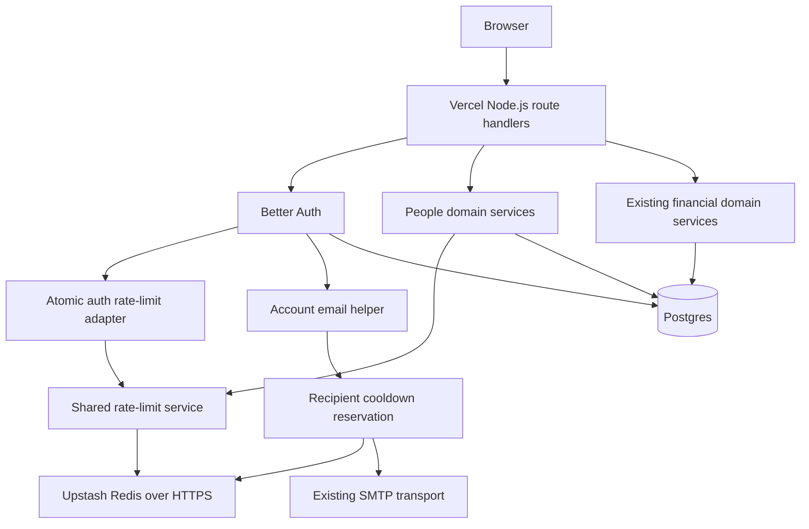

# Upstash: first rollout architecture

Date: 2026-11-10. Status: implemented locally; production provisioning and provider smoke checks pending.
Decision: [D-041](decisions.md#d-041---2026-11-09---upstash-for-shared-rate-limiting).

## Scope and boundaries

Use one managed Upstash Redis database for short-lived abuse-control state.
Move existing Better Auth and people-operation counters out of Postgres. Add
recipient cooldowns for verification and password-reset mail as a second step
within this rollout. The user approved the proposed email policy on 2026-11-10.

Postgres remains authoritative for sessions, credentials, verification tokens,
invites, permissions, financial data, idempotency records and the balance cache.
Redis never participates in a money transaction. HTTP access to Redis does not
replace the required pg connection or interactive Postgres transactions.

Do not add insights caching, queues, session caching or a blanket limiter around
all app requests in this rollout. Existing sessions must still be able to read
expenses and record money operations when Redis is unavailable, subject to the
existing database-backed authentication and authorization checks.



## Existing behavior to preserve

| Entry point                                        | Current policy                                     | Target integration                                  |
| -------------------------------------------------- | -------------------------------------------------- | --------------------------------------------------- |
| Better Auth HTTP requests                          | Configured fallback: 30/60 seconds per IP and path | Supported rule callback plus request plugin         |
| Sign-in/sign-up/change-password/change-email paths | Installed Better Auth special rule: 3/10 seconds   | Preserve the effective rule supplied by Better Auth |
| Password-reset requests and verification resend    | Installed Better Auth special rule: 3/60 seconds   | Preserve the effective rule supplied by Better Auth |
| `findPeople()`                                     | 30/60 seconds per authenticated viewer             | Shared service before the read transaction          |
| `sendFriendRequest()`                              | 10/60 seconds per authenticated viewer             | Shared service before the business transaction      |

Source: `src/lib/auth/auth.ts`, `src/lib/domain/people.ts`, installed
`better-auth/dist/api/rate-limiter/index.mjs` and
`@better-auth/core/dist/types/init-options.d.mts` (Better Auth 1.7.18).
The auth fallback is not a second aggregate limit layered over special rules.
Direct server-side `auth.api` calls do not receive Better Auth's HTTP limiter;
retain session guards, and enforce mail cooldowns in the shared mail helper.

Friend-request attempts that pass input validation consume allowance even when
the later operation fails or repeats an idempotency key. Do not refund counters
after a transaction rollback. Keep the seven-day declined-request business rule
in Postgres; it is not a short-lived rate-limit counter.

## Service and atomicity

Create a server-only `src/lib/rate-limit/` module with:

- `client.ts`: lazily initialized, reusable `@upstash/redis` HTTPS client;
  explicit bounded request timeout and no automatic retry of consuming calls.
- `keys.ts`: namespace construction and HMAC-SHA256 identifiers.
- `policies.ts`: named policies, limits, window duration and algorithm mode.
- `consume.ts`: provider-independent consume operation returning allowed/denied,
  remaining allowance and retry delay; a separate unavailable error.
- `scripts.ts`: small atomic Redis Lua operations, tested with concurrency.
- `better-auth-storage.ts`: consumes the effective Better Auth rule and returns native HTTP responses through a request plugin.

Use `@upstash/redis` directly for this rollout. Do not blindly substitute the
stock fixed-window limiter for the installed auth semantics. Better Auth's
current counter expires a window after the last allowed request; people limits
expire a window after the first allowed request. Preserve both behaviors:

1. Read the counter and remaining TTL in one Lua execution.
2. If absent, create count 1 with the policy TTL.
3. If at the maximum, deny and return the remaining TTL without extending it.
4. Otherwise increment atomically. Refresh TTL for auth; preserve TTL for people.
5. Return the decision from that same execution. Missing TTL or malformed state
   is an unavailable result, not permission to proceed.

Use Redis TTL as the time authority. Every key expires; blocked requests must not
prolong a lockout. Validate policy parameters before execution. Include policy
version and window/maximum in the key so rule changes cannot reinterpret state.
These are bounded-window counters, not exact rolling event logs.

A lost response may mean the counter was already consumed. Treat it as
unavailable and do not replay automatically. Conservative overcount is preferable
to admitting a request without a confirmed decision. Do not queue requests until
allowance returns or maintain a local allow-counter fallback.

For people operations: authenticate and parse first, then consume, then run the
existing active-viewer and visibility guards in the database operation. Keep all
business locks needed for correctness, but remove locks used only for the old
counter. Never hold a Postgres transaction open during Redis network I/O.

## Authentication integration

Use a `customRules` callback matching `/**` and an `onRequest` plugin together.
Do not add Better Auth `secondaryStorage`, which could also change session/token
storage behavior. Custom-storage exceptions escape the installed router's error
handler. The rule callback consumes the effective rule in Redis, stages a native
429/503 response in a request-keyed WeakMap, and returns false to prevent a second
consume. The plugin immediately returns any staged response before the endpoint
executes. HTTP tests verify special-rule preservation and outage responses.
Keep `/api/auth/[...all]/route.ts` as the unmodified Better Auth handler.
Re-run Better Auth CLI generation during implementation and reconcile any schema
output; do not remove the old rate-limit tables in the initial deployment.

Let Better Auth resolve paths, IP normalization and special rules. Configure its
trusted IP header for the actual Vercel ingress and verify that forged forwarding
headers cannot select arbitrary buckets. Do not fall back across untrusted
client-supplied headers. Preserve IPv6 subnet normalization. A missing trusted IP
must never disable protection; test the shared fallback bucket and log only the
configuration warning. An additional reverse proxy requires a separate ingress
review before launch.

The installed auth limiter emits its native `429` body and `X-Retry-After` header.
Preserve these for Better Auth client compatibility. App endpoints use the normal
`{ error: { code, message } }` envelope and standard `Retry-After` seconds.
Do not claim that auth already implements the app error envelope.

## Failure policy (confirmed)

The user selected temporary errors when Redis cannot enforce protection.

| Outcome                                                                                       | Behavior                                                                        |
| --------------------------------------------------------------------------------------------- | ------------------------------------------------------------------------------- |
| Known exhausted allowance                                                                     | `429`, retry delay from remaining TTL                                           |
| Timeout, network error, exhausted provider quota, missing credentials, invalid Redis response | `503`, generic temporary-unavailable message; protected action does not execute |
| Unprotected app operation                                                                     | Continues with existing Postgres guards                                         |

Use a 1-second end-to-end deadline, including connection and response
parsing; verify SDK timeout behavior instead of relying on defaults. Return
`RATE_LIMIT_UNAVAILABLE` from app endpoints and an appropriate native Better Auth
service-unavailable error for auth. The auth adapter's thrown-error translation
must be integration-tested: a generic exception becoming `500` is not sufficient.
Resolve this through supported auth configuration/plugin hooks, not custom logic
in the catch-all handler. If the installed lifecycle cannot map the error, resolve
that compatibility issue before enabling auth Redis limits.

Do not silently fall back to Postgres or memory at runtime. Independent stores
would create additional allowance and make outages hard to reason about.
Preserve form input on errors; suppress automatic query retries for 429, and
avoid immediate retry loops on 503. Do not expose credentials or provider errors.

## Email cooldowns (approved 2026-11-10)

At most one account email per recipient and purpose per 60 seconds,
plus five per hour across verification and reset combined. An attacker can
consume a recipient's allowance, so keep
cooldowns short and do not introduce day-long recovery lockouts.

Use the same trim/lowercase normalization as account identity and HMAC the
recipient; never store addresses, tokens, links or message bodies in Redis.
Reserve both cooldown and hourly allowance atomically before sending. SMTP runs
outside Redis and Postgres transactions through Better Auth's after-transaction
hook. Do not release a reservation after an
ambiguous SMTP failure: the message may already have been accepted.

Recipient-level suppression returns the usual generic response, not a distinct
429 that reveals whether mail was sent. IP-level exhaustion can return 429.
For public reset/resend requests, unavailable-service behavior must be identical
for eligible, absent and ineligible identities: perform a recipient-policy
preflight before account lookup (also before signup writes), and carry a request-scoped reservation to the mail
helper so it is not consumed twice. Other internal sends reserve in the helper.
The reservation is internal state, never a client-controlled bypass token.

Keep the `.invalid` mail refusal as a final transport guard. Test existence and
placeholder privacy across cooldown, outage and SMTP-failure paths. If preflight
and callback ordering cannot preserve generic responses in the installed auth
version, leave email cooldowns disabled until that integration is resolved.

## Deployment configuration and data lifetime

Use a single Upstash primary near the deployed Vercel function region; measure
latency before selection. Do not assume the browser's location is the server
region. No read replicas or analytics in this rollout.

Server-only configuration:

| Variable                   | Purpose                                        |
| -------------------------- | ---------------------------------------------- |
| `UPSTASH_REDIS_REST_URL`   | HTTPS endpoint                                 |
| `UPSTASH_REDIS_REST_TOKEN` | Server write credential, never `NEXT_PUBLIC_*` |
| `RATE_LIMIT_KEY_SECRET`    | Independent HMAC secret                        |
| `RATE_LIMIT_NAMESPACE`     | Stable project/environment namespace           |

Example key: `sd:production:rl:v1:people-search:60:30:<hmac>`.
HMAC the viewer ID, auth-generated key or normalized recipient with purpose
separation. HMAC is pseudonymization, not anonymization. Do not log identifiers.
Keep keys stable across deployments; do not use deployment IDs in production
keys. Rotation or policy-version changes reset allowance and require a controlled
cutover. Avoid cache eviction of limiter keys; capacity errors must fail closed.

Provision through Vercel Marketplace or Upstash directly and explicitly select
the Free plan. Confirm the actual account allowance. Production credentials must
not be available to untrusted previews. Prefer local Redis fixtures for tests;
use a controlled Upstash staging namespace for provider smoke tests. Prefixes
prevent accidental collisions but do not provide credential or quota isolation.
Never run load or destructive tests against the production database.

## Free-tier capacity and observability

Published Upstash free allowance checked 2026-11-09: one database, 500,000
commands/month, 10 GB bandwidth, approximately 250 MB storage (the provider page
also lists 256 MB in its comparison table). Confirm during provisioning.

Lua execution and its internal commands consume quota; one HTTP call is not one
command. Measure our scripts against provider usage. As a conservative planning
example, reserve 100,000 commands for headroom: at six commands per check, the
remaining 400,000 supports about 66,000 checks/month, or 2,200/day. Multiple
checks per request, email reservations, denied traffic and staging all consume
that budget. This is an estimate, not measured capacity or a user-count promise.

Record aggregate allowed/denied/unavailable counts, policy, latency and deployment
version in existing server logs without emails, IPs, user IDs or Redis keys.
Inspect provider usage at 50%, 75% and 90% of quota; use dashboard notifications
where available, otherwise a documented manual check. Set a prelaunch target of
under 150 ms p95 limiter latency and validate in the deployed region.
At high usage investigate bots/retry loops and apply appropriate Vercel firewall
controls; do not disable limits or automatically upgrade to a paid plan.
Application limiting happens after function invocation and does not itself avoid
Vercel invocation costs. Distributed abuse can exhaust even a correct limiter's
free quota; 503 is the explicitly accepted outcome when protection is unavailable.

## Implementation sequence and acceptance gates

1. Recipient thresholds and failure policy are confirmed (D-042).
2. Update the local OpenAPI contract and collection generator for affected app
   429/503 responses and headers, preserving auth-native responses. Lint and
   generate tests before implementation. Do not publish cloud Postman artifacts.
3. Implement the shared Redis service and atomic scripts, then the people limits.
4. Implement the Better Auth adapter; verify supported 503 translation, special
   rules, ingress IP handling and session independence before switching auth.
5. Add email reservation/preflight integration after its privacy tests pass.
6. Add sanitized environment examples and operator deployment instructions.
7. Run typecheck, lint, unit/integration tests, Postman lint/API tests and build;
   run auth/browser flows with isolated fixtures and real Upstash smoke checks.
8. Deploy a controlled preview, verify quota/latency and failure behavior, then
   cut over production. Keep old Postgres counter tables for rollback; remove
   them only in a later generated migration after the rollout is stable.

Expected implementation files: `src/lib/rate-limit/*`, `src/lib/auth/auth.ts`,
`src/lib/domain/people.ts`, `src/lib/mail/transport.ts`,
`src/lib/utils/errors.ts`, `src/lib/api/client.ts`, affected retry hooks,
environment examples, the Postman collection generator and generated contract,
tests and deployment documentation. No financial domain change is required.

Required tests:

- Two independent clients concurrently consume one bucket: exactly the maximum
  succeeds, keys expire, and blocked traffic does not extend TTL.
- Auth expiry refresh and people fixed expiry match existing semantics.
- Distinct viewers/policies/environments cannot consume each other's allowance.
- Failed/repeated friend requests count; existing guards and seven-day business
  cooldown remain effective. No Redis I/O occurs while holding business locks.
- Real auth HTTP requests preserve special rules, native 429 headers and 503
  behavior; forged IP headers do not bypass limits. Server session reads and
  logout/revocation implications are explicitly exercised during Redis outage.
- Email concurrent sends, purpose limits, unknown/placeholder privacy, timeout
  and ambiguous SMTP outcomes follow the approved policy without double counting.
- Inject Redis timeout, rejected credentials, quota errors and malformed replies:
  protected handlers do not run, no automatic fallback occurs, and existing
  authenticated money operations still work through Postgres.
- Client 429/503 states preserve input and do not amplify traffic through retries.

Rollback is an explicit deployment of the prior Postgres-backed implementation,
not automatic failover. Old counters may be stale, and mixed deployments can
admit allowance in both stores. Drain old traffic/use deployment routing controls
and document the reset window; rollback does not promise continuous counters.
Never flush a shared Redis database. Leave short-lived rollout keys to expire.

## References and verification limits

- [Upstash pricing](https://upstash.com/pricing/redis)
- [Rate-limit command accounting](https://upstash.com/docs/redis/sdks/ratelimit-ts/costs)
- [Better Auth rate limiting](https://better-auth.com/docs/concepts/rate-limit)
- [Vercel request headers](https://vercel.com/docs/headers/request-headers)
- [Vercel Redis integrations](https://vercel.com/docs/redis)

HTTP auth session checks and sign-out are protected and return 503 during an outage;
server-side session checks used by app routes continue through Postgres. Session
revocation through existing app routes retains its existing database guards.

The installed Better Auth implementation is the integration baseline when online
examples differ. This document does not prove provider connectivity, latency,
command usage, actual account allowances or lifecycle error translation; those
are explicit implementation/release gates. No infrastructure is provisioned by
this architecture change.

## Operator setup

Before deploying this code, create a Free Upstash database near the Vercel function
region and configure these server-only production environment variables:

- `UPSTASH_REDIS_REST_URL` and `UPSTASH_REDIS_REST_TOKEN` from the provider.
- `RATE_LIMIT_KEY_SECRET`: a new random secret of at least 32 characters.
- `RATE_LIMIT_NAMESPACE=sd:production`, stable across deployments.

Missing configuration intentionally returns 503 for protected actions. Do not
roll out before setting it. Keep the Free plan and confirm provider capacity and
eviction behavior; never enable eviction that can silently discard live limits.
Do not place production credentials in preview deployments. The local client
allows HTTP only on loopback outside Vercel (or under the test runner).

Local fixtures (PowerShell; Docker Desktop must be running):

```powershell
docker network create spending-diary-test
docker run --detach --rm --name spending-diary-redis-test --network spending-diary-test redis:7-alpine
docker run --detach --rm --name spending-diary-redis-http-test --network spending-diary-test --publish 127.0.0.1:58080:80 --env SRH_MODE=env --env SRH_TOKEN=local-test-token --env SRH_CONNECTION_STRING=redis://spending-diary-redis-test:6379 hiett/serverless-redis-http@sha256:5b0bb9239fce53abf87b2018a7a0deb9ec7bd900c5360738fe5fbeeb426f9150
```

Reuse existing named fixtures instead of creating duplicates. PostgreSQL setup is
in the root README. Integration tests and the Postman runner use only this
loopback Redis endpoint, fixture credentials and random namespaces; no production
Redis environment is inherited. Keys expire naturally (up to one hour), except
the deliberately corrupt test key, which disappears when the disposable container
is removed. Stop the Redis HTTP container and Redis container after tests.

The SDK runs against real Redis through the local HTTP adapter. HTTP fault tests
also exercise the real SDK against a loopback server returning quota/auth errors,
malformed replies and timeouts. This verifies client behavior and Lua semantics;
it does not establish Upstash account limits, billing, region latency, or Vercel
header sanitization. Verify those in a controlled preview before production.

Better Auth CLI generation was run using an ignored schema-only config derived
from the actual user additional-fields definition because the CLI rejects
server-only imports. The generated user/session/account/verification fields
already exist in the Drizzle schema; retain the project's names, timestamp modes,
constraints and old limiter tables. No migration is needed for this rollout.

## Verification recorded 2026-11-10

- Typecheck, ESLint, production build and Postman collection/environment/spec
  lint passed. The build needed network access for the existing Google Font.
- Vitest: 33 files, 267 tests passed, including real Redis concurrency/expiry,
  actual SDK HTTP faults, auth error translation and email privacy. The outage
  route test substitutes only Next.js's post-response push scheduler, which needs
  a live request context; the production HTTP/browser runs cover that context.
- Production HTTP collection: 154 requests, 371 assertions, zero failures;
  `Postman exit code: 0.`
- Chromium: all 35 browser tests passed against the isolated production app.
- Better Auth schema generation completed with no required database change.
- Money review: no blocking or should-fix findings. Financial transactions,
  ledger/balance ownership, authorization, idempotency and soft deletes remain
  intact. Redis calls are outside the people business transactions; no auth
  catch-all logic, financial schema changes or financial data caching was added.
- Dependency audit reported six existing findings (two low, four moderate) in
  unchanged shadcn/ts-morph-related package versions; neither new dependency was
  implicated. These were not changed as part of this rollout.

Real Upstash provisioning, quota/eviction settings, measured command consumption,
region latency and Vercel ingress sanitization remain production release gates.
No production credentials, database migrations or deployment were applied.
